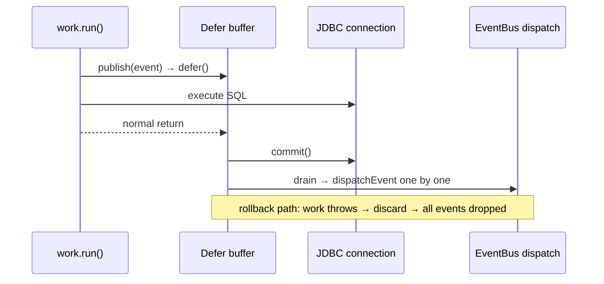

# Scope primitives — Defer and ScopedCache

## In One Sentence

**"Run side effects only after the current boundary commits successfully; discard them if it fails."** `Defer` is the deferred-action facade in freeway-commons, built on the JDK's `ScopedValue` with zero external dependencies; `ScopedCache` is the value facade over the same `ScopeSession`. It handles "do it after commit" side effects; `ScopedCache` handles value caching that is "reused within the scope and cleaned up on exit". Both are two facades over the same `ScopeSession`: one session state (`CURRENT` scope + `CACHE` value access view) and one close algorithm (actions first, then values).

## Mental Model: the Commit Tray

Imagine you have a tray. While working, you toss slips of paper with to-dos into the tray. Work completes successfully → process the slips in the tray one by one. Work fails → the whole tray is dumped, and nothing happens.

```java
Defer.within(() → {              // tray in place
    doWork();                    // the core work
    Defer.defer(() → sideA());   // slip A → tray
    Defer.defer(() → sideB());   // slip B → tray
});                              // success → A runs, B runs
                                 // exception → A and B are discarded
```

Calling `Defer.defer()` outside a scope? There is no tray, so it runs immediately. The caller does not need to know whether it is inside a scope.

## Core API

| API | Description |
|-----|------|
| `Defer.within(Runnable)` | Opens a scope; drains on normal return, discards on exception |
| `Defer.within(Supplier<T>)` | As above, returning the work result (no result on timeout/exception) |
| `Defer.rollback()` | Marks the current action scope: discards deferred actions on normal return; no-op outside a scope |
| `Defer.defer(Runnable)` | Enqueues inside a scope; runs immediately outside one |
| `Defer.defer(String id, Runnable)` | Named action; returns `DeferAction` for chaining `.before(id)` / `.after(id)` |
| `Defer.supply(Callable<T>)` | Deferred value; returns `Supplier<T>`, computes and caches on the first `get()`; if never `get()`-ed, computed at commit |
| `Defer.supply(String id, Callable<T>)` | Named deferred value; returns `DeferAction`, supports ordering and `.value()` retrieval; runs immediately outside a scope |
| `Defer.isActive()` | Whether it is inside a scope |

## Usage Examples

### Basics: Open a Scope, Defer Execution

Scope returns normally → all deferred actions run in registration order. Scope throws → all are discarded.

```java
// inside a scope — actions are buffered
Defer.within(() → {
    System.out.println("① start work");
    Defer.defer(() → System.out.println("③ side effect A"));   // enqueued
    Defer.defer(() → System.out.println("④ side effect B"));   // enqueued
    System.out.println("② work done");
});
// output order: ① start work → ② work done → ③ side effect A → ④ side effect B

// outside a scope — runs immediately
Defer.defer(() → System.out.println("run directly"));           // prints immediately
```

### Naming + Ordering

Give an action a name, then declare which other action it must run before / after:

```java
Defer.within(() → {
    Defer.defer("index",  () → rebuildIndex());           // unconstrained, floats freely
    Defer.defer("cache",  () → clearCache()).after("index");  // must run after index
    Defer.defer("notify", () → sendNotification()).after("cache", "index");  // last
});
// execution order: index → cache → notify

// before is supported too
Defer.defer("prep", () → prepare()).before("index");      // must run before index
// execution order: prep → index → cache → notify
```

Constraint rules:
- A missing target (an id that does not exist) → silently ignored, no error
- Duplicate id → `IllegalStateException`
- Circular dependency → `IllegalStateException`
- Execution grouping: constrained named (topological order) → unconstrained named (registration order) → anonymous (registration order) —
  named actions as a whole run before anonymous ones, even if the anonymous ones were registered earlier; when strict registration order is needed, use all anonymous or all named

### Manual Rollback

When you do not want to throw but do want to discard deferred actions:

```java
Defer.within(() → {
    preCheck();
    Defer.defer(() → doAfterSuccess());

    if (failedPreCheck) {
        Defer.rollback();   // doAfterSuccess will not run
        return;             // normal return, no exception
    }

    doMainWork();           // normal flow continues
});
// if rollback() is called, the scope ends normally but all actions are discarded
```

### Deferred Values

`supply()` returns a `Supplier<T>`. Inside a scope: the first `get()` computes and caches immediately; if `get()` is never called, it is computed once at scope commit. Outside a scope: every `get()` computes immediately.

```java
// — inside a scope —
Supplier<String> cache;

Defer.within(() → {
    cache = Defer.supply(() → expensiveQuery());   // not computed yet
    doWork();
});
String result = cache.get();  // the first get() computes; later get() calls return the cached value
String again = cache.get();   // no recomputation, returns the cache directly

// — outside a scope —
Supplier<String> s = Defer.supply(() → expensiveQuery());
s.get();  // computes immediately, every get() recomputes
```

### Checking Whether You Are Inside a Scope

```java
void maybeDefer() {
    if (Defer.isActive()) {
        Defer.defer(() → System.out.println("deferred"));
    } else {
        System.out.println("immediate");
    }
}
```

### Nested Scopes

An inner scope is independent of the outer one — success/rollback on one side does not affect the other:

```java
Defer.within(() → {
    Defer.defer(() → log.add("outer-before"));

    Defer.within(() → {
        Defer.defer(() → log.add("inner"));           // the inner one drains immediately
    });                                               // an inner failure does not affect the outer one

    Defer.defer(() → log.add("outer-after"));
});
// output: inner → outer-before → outer-after
```

## Scenario-Driven

### Scenario 1: DB Transaction + EventBus (built in, zero user code)

The most common scenario — you write no Defer code at all; the framework handles it:

```java
db.transaction(() → {
    db.execute("INSERT INTO posts ...");
    bus.publish(new PostCreatedEvent(post));     // looks immediate, actually deferred
    db.execute("UPDATE counts ...");
});
// commit succeeds → event published
// rollback → event not sent

// the same bus.publish(), called outside a transaction, sends immediately — users need not distinguish
bus.publish(new SomeOtherEvent());              // published immediately
```

#### Three-way Wiring (code level)

Three components collaborate in a decoupled way through commons' `Defer`: db does not depend on ioc, and ioc does not depend on db:

```java
// freeway-db · DatabaseImpl.transaction() — opens a Defer scope; the commit happens inside it
Defer.within(() -> {
    ScopedValue.where(tx, binding).run(() -> work.run());   // ① work runs
    raw.commit();                                            // ② commit
});                                                          // ③ leave scope → drain → event dispatch

// freeway-ioc · EventBus.publish() — probes the scope; enqueues when active
if (Defer.isActive() && !(event instanceof DeadEvent)) {
    Defer.defer(() -> dispatchEvent(event));
}
```

#### Sequence



#### Sequence Contract and Semantic Boundaries

- **Commit happens before drain** — events are dispatched only after a successful commit; on rollback `Defer` discards and the events are dropped as a whole. **Events live and die with the transaction**; "rolled back but the event was sent" cannot happen.
- **The `Error` path**: work throws an `Error` (such as `AssertionError`) → `Defer.within`'s `catch(Throwable)` discards + rethrows → `transaction()`'s `catch(Throwable)` performs the rollback. Before the fix only `Exception` was caught, so an `Error` slipped past rollback, and the `setAutoCommit(true)` that restores the connection state committed the failed transaction instead.
- **The drain failure boundary**: an individual action throwing happens **after** commit; `ScopeSession.drain` does `catch (Throwable)` per action and only logs a WARN, and the scope still returns normally — so the caller sees **success** while events are **partially dispatched** (the remaining actions still run). Only a failure of "action ordering" itself (dependency constraints that cannot be satisfied) rethrows. This is a defensible semantic (cleanup actions must run to completion); the cost is that an event failure is invisible to the caller and must be observed on the logging side.
- **Cross-thread**: `ScopedValue` is bound to the current thread and does not propagate to child threads. In a child thread `Defer.isActive()` is false, so `publish()` dispatches immediately and is not protected by the transaction; for this reason `publishAsync` also keeps its immediate semantics (it does not participate in Defer).

### Scenario 2: DB Transaction + Cache Invalidation (manual defer)

```java
db.transaction(() → {
    db.execute("UPDATE posts SET title = ? WHERE id = ?", title, id);
    Defer.defer(() → cache.invalidate("posts:" + id));
    // the cache is invalidated only after the UPDATE actually commits
});
```

### Scenario 3: HTTP Request Lifecycle

```java
Defer.within(() → {
    handleRequest(req, res);                       // core handling
    Defer.defer(() → metrics.record(method, duration));  // metrics
    Defer.defer(() → accessLog.write(entry));            // access log

    if (res.status() >= 400) {
        Defer.rollback();  // an error response must not be counted as a successful request
        return;
    }
});
// only successful requests record metrics and access logs
```

### Scenario 4: Kafka Consumption — the offset commit boundary

```java
Defer.within(() → {
    for (var record : records) {
        process(record);
        Defer.defer(() → bus.publish(new RecordProcessed(record)));
    }
    consumer.commitSync();  // offset acknowledgment
});
// events are published only after the offset commit succeeds
```

### Scenario 5: Batching — all or nothing

```java
Defer.within(() → {
    for (var row : rows) {
        db.execute("INSERT INTO ledger (amount, memo) VALUES (?, ?)", row.amount, row.memo);
    }
    Defer.defer("index",  () → searchIndex.rebuild()).after("stats");
    Defer.defer("stats",  () → stats.refresh());
    Defer.defer("notify", () → bus.publish(new BatchDone())).after("index");
});
// after all INSERTs commit: stats → index → notify run in order
// any one failure → all discarded
```

### Scenario 6: Deferred Value — an audit snapshot

```java
Supplier<AuditSnapshot> snap = Defer.supply(() → snapshotDao.build());

db.transaction(() → {
    orderService.place(order);
    // snapshotDao.build() has not run yet — deferred until after commit
});

// the transaction has committed; the snapshot reflects a consistent state
AuditSnapshot s = snap.get();
```

Outside a scope, the Supplier returned by `supply()` computes immediately on every `get()` and uses no cache.

## Driving Boundaries

Defer itself is generic. Any boundary with "success / rollback" semantics can use it:

| Boundary type | Who opens the scope | Commit moment | Rollback moment |
|---------|------------|---------|---------|
| DB transaction | `DatabaseImpl.transaction()` | `raw.commit()` succeeds | work throws |
| HTTP request | Filter / framework layer | after the response is written | request handling throws or manual `rollback()` |
| Kafka consumption | Consumer loop | after `commitSync()` | processing throws |
| Batch job | Job executor | all batches written | any step fails |
| Custom business | your own service layer | lambda returns normally | throws or manual `rollback()` |

## ScopedCache — Scoped Value Cache

`ScopedCache` and `Defer` share the same `ScopeSession`: `within` opens the values' **access window**, `get` creates on first use and reuses, and exit cleans up. A value's **lifecycle** can be longer than the access window — when opened inside an action scope the value attaches to that action scope and lives until it closes.

### Core API

| API | Description |
|-----|------|
| `ScopedCache.within(Runnable)` / `within(Supplier<T>)` | Opens the access window; inside an action scope it attaches to that scope; otherwise creates a new value scope and cleans up on exit |
| `ScopedCache.within(Function<ScopeSession,T>)` | As above, passing a read-only `ScopeSession` token (`isActionScope()` / `isClosed()`) |
| `ScopedCache.computeIfAbsent(key, factory)` | Creates and caches on first use inside the window; outside the window it creates directly, with no caching and no cleanup |
| `ScopedCache.computeIfAbsent(key, factory, onExit)` | As above, and calls `onExit` once per value when the scope that owns it closes |
| `ScopedCache.onClose(handler)` / `removeOnClose(handler)` | Process-level cleanup handler, called once for each cached value |
| `ScopedCache.isActive()` | Whether it is currently inside the access window (not "whether the current action holds values") |
| `ScopedCache.currentSession()` | The read-only `ScopeSession` token inside the window, otherwise `null` |

### Examples

```java
ScopedCache.within(() -> {
    Connection conn = ScopedCache.computeIfAbsent("conn", () -> dataSource.getConnection());
    Defer.within(() -> Defer.defer(() -> conn.flush()));  // the action can see conn
});
// conn is cleaned up when the scope that owns it closes
```

Inside an action scope:

```java
Defer.within(() -> {
    ScopedCache.within(() -> {
        ScopedCache.computeIfAbsent("conn", () -> open(), c -> close(c));
        Defer.defer(() -> use(ScopedCache.computeIfAbsent("conn", () -> open())));
    });
    // outside the block: isActive() == false, get creates uncached values; but conn is still there,
    // and close(c) runs only when this action scope closes
});
```

### Semantics

- **Lifecycle**: a value is cleaned up when the session that owns it closes; when opened inside an action scope, the owner is that action scope, not the inner `within` block.
- **Access window**: only inside a cache block and during action drain does `get` read and write the cache; outside the block `isActive()` is false and `get` does not cache. This avoids the leak of "the whole action can still cache after the inner cache ends".
- **Close order**: actions run first, values are cleaned up afterwards; rollback discards only actions, while values are still cleaned up (cleanup must happen).
- **Failure and repetition**: each value's entry cleanup runs before the global `onClose` handler; the same value (identity) is handled only once; a handler exception is only logged and does not skip the remaining values.
- **Read-only token**: `ScopeSession` provides no `rollback`/`close`; rollback uses `Defer.rollback()`, and closing is owned by the facade that opened it.
- **Boundary scope**: `ScopeBoundary.within` is based on the same value scope; opened inside `Defer`, beans attach and live until the action closes, and no new BOUNDARY bean is resolved outside the access window.

### Do Not Use It For

- Process-level caching (use `ConcurrentHashMap` or Caffeine, etc.) — values are cleaned up when the scope closes.
- Values that must be shared across threads — `ScopedValue` does not propagate; in a child thread `isActive()` is false.
- Cleanup actions that must run "even on failure" — use `try/finally`; `ScopedCache`'s cleanup is value release, not a transactional action.

## Nesting with ScopedCache

`Defer` and `ScopedCache` share the same `ScopeSession` (one session state, one close algorithm; `CURRENT` defines the scope,
`CACHE` defines the values' access window), so **both nesting directions are safe**:

```java
ScopedCache.within(() -> {
    Defer.within(() -> {
        Object v = ScopedCache.computeIfAbsent(k, factory);
        Defer.defer(() -> use(v));   // the action sees the outer cached value
    });
});

Defer.within(() -> {
    ScopedCache.within(() -> {
        Object v = ScopedCache.computeIfAbsent(k, factory);
        Defer.defer(() -> use(v));   // the inner cache's values attach to the outer action scope, which is still open
    });
});
```

There are only two rules, governing lifecycle and access respectively:

1. **When a value scope is opened inside an action scope, values attach to that action scope**, and live until it closes; the close order is fixed as
   "actions first, then values", so a deferred action can always use cached resources. An inner `ScopedCache.within` no longer cleans up early when it exits.
2. **The values' access window covers only the cache block (and action drain)**: outside the block `ScopedCache.isActive()` is
   false and `get` creates uncached values; the values themselves remain in the action scope and are cleaned up only when it closes.

This replaces the old rule that "the cache must be outermost" and also eliminates the leak of "the whole action can still cache after the cache block ends".
There is no nesting WARN, and a composition entry point such as `Scopes` is no longer needed.

## When Not to Use It

- **Cleanup logic** (such as closing a stream or releasing a lock) — use `try/finally`. Defer handles only side effects that "happen after success"; it discards them on failure.
- **Cross-thread fire-and-forget** — `ScopedValue` is bound to the current thread. That is why `publishAsync` keeps its immediate semantics (it does not participate in Defer).
- **Long-running asynchronous work** — deferred actions run inline when the scope drains. If they must happen after async work, submit them to a thread pool from inside the deferred action: `Defer.defer(() → executor.submit(heavy))`.

## Implementation

`Defer` and `ScopedCache` share one package-private `ScopeSession` state: the action list, ordering constraints, value cache, per-entry cleanup, and global handlers all live in the same session. `CURRENT` binds the scope, and `CACHE` binds the same session only within the access window; on commit, actions run first (with `CACHE` bound during actions, so actions can see values) and values are cleaned up afterwards; rollback discards only actions, while values are still cleaned up. Threads are isolated by nature — work on different threads does not interfere, and virtual threads are fine too. `ScopeSession` exposes only the read-only `isActionScope()` / `isClosed()`; rollback and closing are owned by `Defer` and by the facade that opened it, respectively.
